<div align="center">


# Estoque Idealization

**Gestão de estoque completa: do almoxarifado ao pedido de compra — com previsão de demanda, scanner de código de barras e assistente com IA.**

[](https://github.com/LucassTml/Estoque_Idealization_CSV_1.0/actions/workflows/ci.yml)


[Funcionalidades](#funcionalidades) · [Telas](#telas) · [Como rodar](#como-rodar) · [Arquitetura](#arquitetura) · [Decisões técnicas](#decisões-técnicas) · [Testes](#testes)

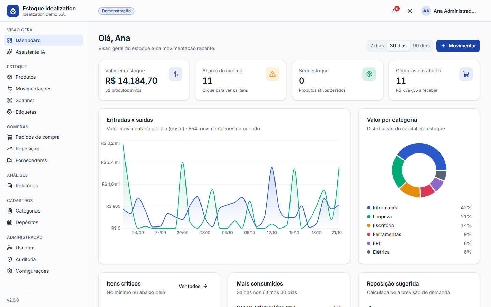

</div>

## Sobre

O Estoque Idealization começou como um trabalho da faculdade em **C + GTK** (a versão 1.0 está preservada em [`legacy/`](legacy/)): um cadastro de itens com login, gravando tudo em CSV. A versão 2.0 é uma reescrita completa como aplicação web moderna, pensada para resolver o problema real de quem cuida de um almoxarifado:

- **Quanto eu tenho e onde está?** Saldo por depósito, histórico imutável de cada movimentação e custo médio ponderado.
- **O que vai acabar e quanto devo comprar?** Previsão de demanda por produto e sugestão de compra que vira pedido com um clique.
- **Como agilizar o dia a dia?** Leitura de código de barras/QR pela câmera do celular, etiquetas em PDF, importação de planilhas e alertas automáticos.

Roda de três jeitos: **link online**, **executável portátil** (um arquivo, sem instalar nada) ou **Docker**.

## Funcionalidades

| Módulo | O que faz |
| --- | --- |
| **Estoque** | Produtos com SKU, EAN, categoria, fornecedor, unidade (inclusive fracionada: kg, m, L), mínimo e máximo. Entradas, saídas, transferências entre depósitos e ajustes de inventário em um **livro (ledger) imutável** com saldo após cada lançamento. Bloqueio de saldo negativo e **custo médio ponderado** automático. |
| **Compras** | Pedido de compra com ciclo rascunho → enviado → recebido, **recebimento parcial**, custo real da nota atualizando o custo médio, PDF do pedido para enviar ao fornecedor. |
| **Reposição inteligente** | Previsão de demanda por produto (**Holt amortecido** para consumo regular, **Croston/SBA** para consumo intermitente), estoque de segurança pelo nível de serviço, ponto de pedido e **geração automática de pedidos por fornecedor**. |
| **Relatórios** | Dashboard com KPIs e gráficos, **curva ABC** (Pareto), giro e cobertura de estoque, itens parados. Exportação em **Excel, PDF e CSV** (o CSV abre direto no Excel em português). |
| **Código de barras** | Etiquetas A4 com **Code 128 + QR Code** desenhados em vetor. **Scanner** pela câmera do celular ou por leitor USB, com entrada/saída rápida. |
| **Assistente com IA** | Pergunte em português ("o que vai acabar este mês?"). O **Claude** consulta os dados por ferramentas **somente leitura** — responde com números reais e não consegue alterar nada. |
| **Alertas** | Aviso de estoque baixo/zerado e **resumo diário** por e-mail (SMTP) e **Telegram**, além do sino de notificações no app. |
| **Segurança** | Senhas com **Argon2**, JWT de curta duração + **refresh token rotativo** em cookie httpOnly (com detecção de reuso), limite de tentativas de login, **4 perfis de acesso** (RBAC) e **trilha de auditoria** com o que mudou, quem, quando e de onde. |
| **Importação** | Planilhas CSV/Excel de produtos (cria ou atualiza pelo SKU) e **migração direta do `estoque.csv` da versão 1.0**. |
| **Experiência** | Interface responsiva, **modo escuro**, **PWA instalável** no celular, primeira execução guiada e conta de demonstração. |

## Telas

| | |
| :---: | :---: |
| 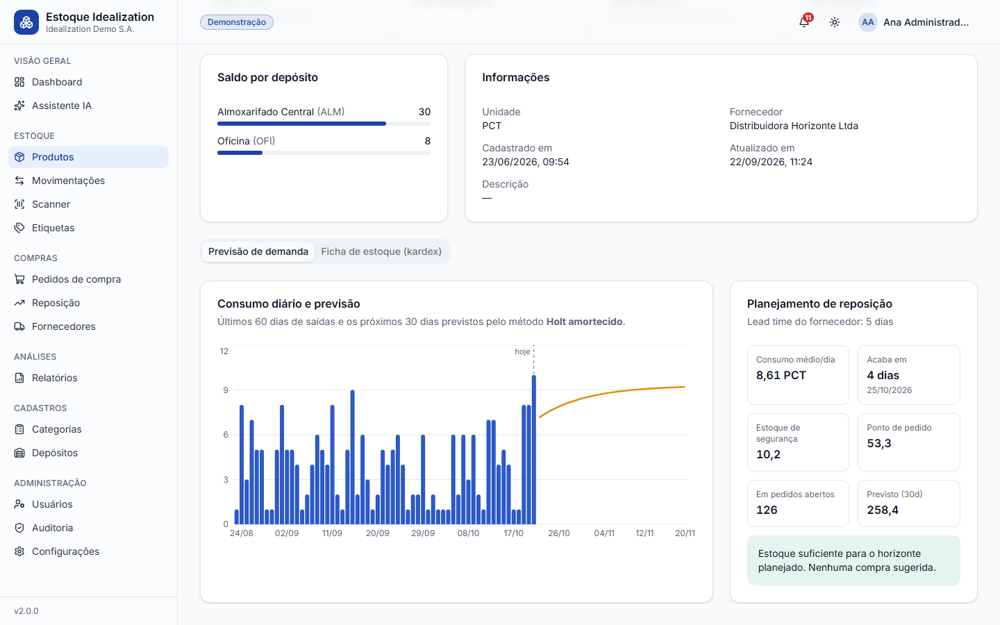<br/>Previsão de demanda e planejamento de reposição | 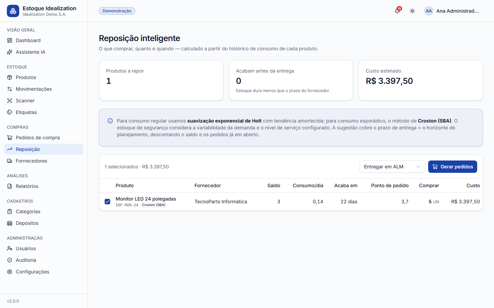<br/>Sugestões de compra que viram pedidos |
| 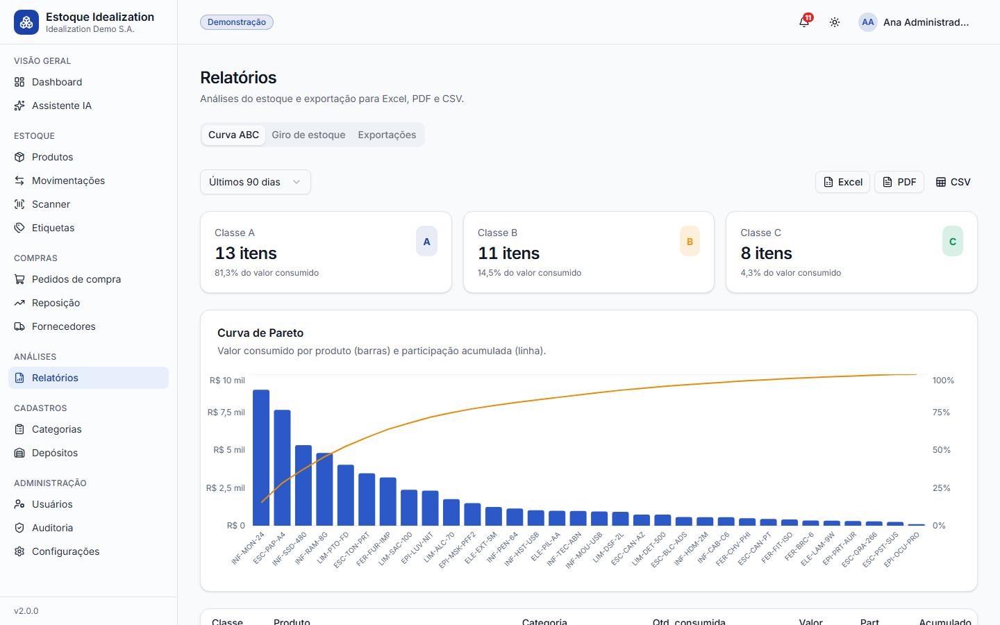<br/>Curva ABC com exportação | 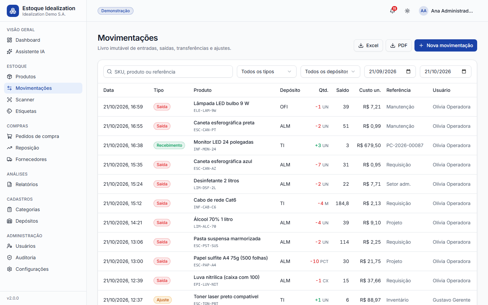<br/>Livro de movimentações com filtros |
| 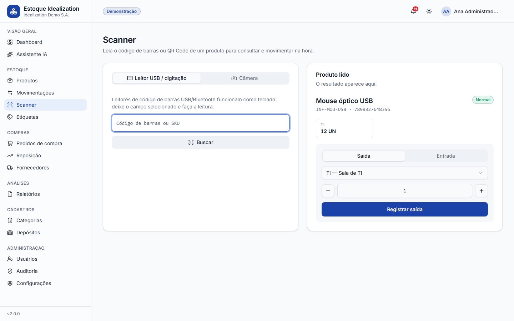<br/>Scanner (câmera ou leitor USB) | 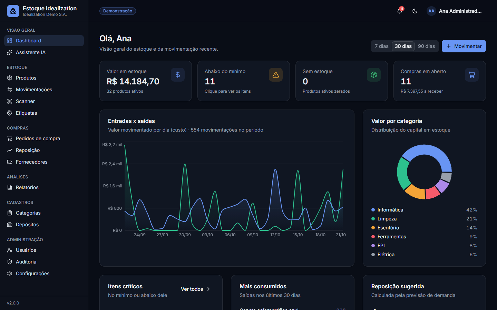<br/>Modo escuro |
| 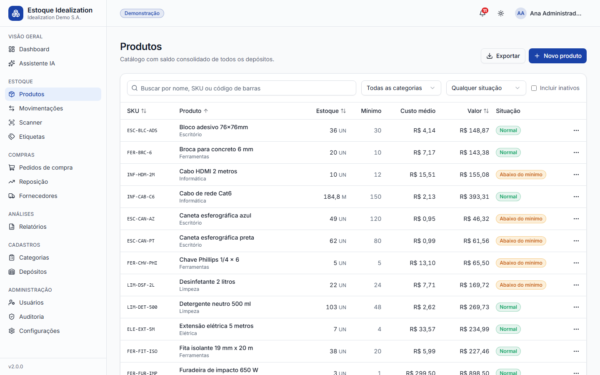<br/>Catálogo com situação do estoque | 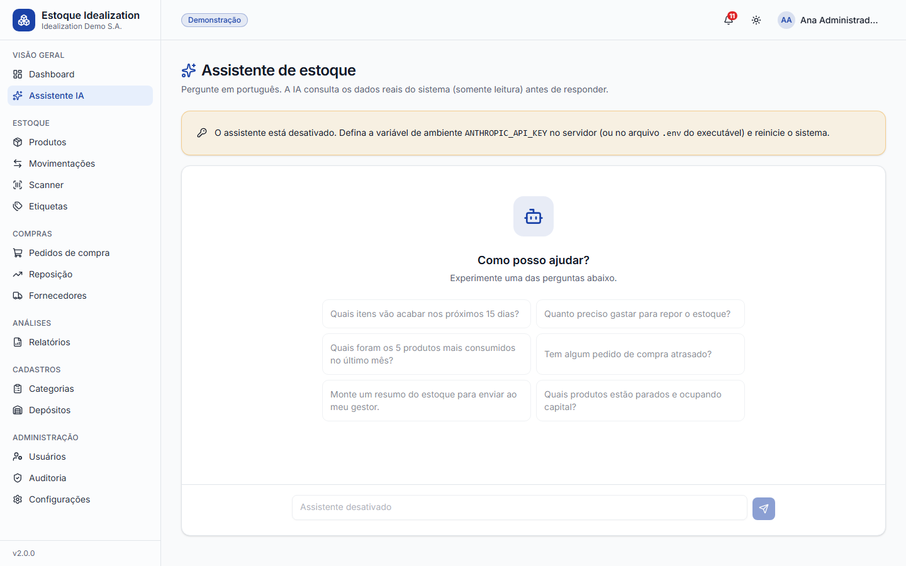<br/>Assistente com IA |

<p align="center">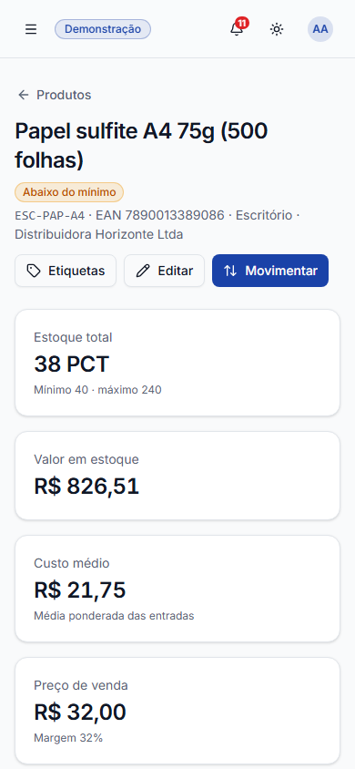</p>

## Como rodar

### 1. Executável portátil (Windows/Linux)

Baixe o `EstoqueIdealization` na página de [Releases](https://github.com/LucassTml/Estoque_Idealization_CSV_1.0/releases) e dê dois cliques. O sistema abre no navegador e os dados ficam numa pasta ao lado do executável — dá para levar num pendrive.

```bash
EstoqueIdealization.exe --demo   # primeiro uso com dados de exemplo
EstoqueIdealization.exe --lan    # libera o acesso pelo celular na mesma rede
```

Para habilitar a IA ou os alertas, crie um arquivo `.env` ao lado do executável (veja [`backend/.env.example`](backend/.env.example)).

### 2. Docker (com PostgreSQL)

```bash
docker compose up --build
```

Acesse http://localhost:8000 e entre com uma das contas de demonstração (senha `demo1234`): `admin@demo.com`, `gerente@demo.com`, `operador@demo.com` ou `leitura@demo.com`.

### 3. Online (Render + Neon, gratuito)

1. Crie um banco PostgreSQL gratuito no [Neon](https://neon.tech) e copie a URL de conexão.
2. Clique em [](https://render.com/deploy?repo=https://github.com/LucassTml/Estoque_Idealization_CSV_1.0) — o [`render.yaml`](render.yaml) já configura tudo; cole a URL do Neon em `DATABASE_URL`.
3. (Opcional) Em *Settings → Secrets* do GitHub, defina `APP_URL` e `CRON_TOKEN` para o [workflow de cron](.github/workflows/cron.yml) enviar o resumo diário e recriar a demonstração toda madrugada.

### 4. Desenvolvimento

Pré-requisitos: [uv](https://docs.astral.sh/uv/) e Node.js 22+.

```bash
# API (http://localhost:8000/api/docs)
cd backend
uv sync
uv run python -m app.seed            # opcional: 120 dias de dados de exemplo
uv run uvicorn app.main:app --reload
```

```bash
# Interface (http://localhost:5173, com proxy para a API)
cd frontend
npm install
npm run dev
```

Gerar o executável: `cd frontend && npm run build`, depois `cd backend && uv sync --group desktop && uv run pyinstaller ../desktop/estoque.spec`.

## Arquitetura

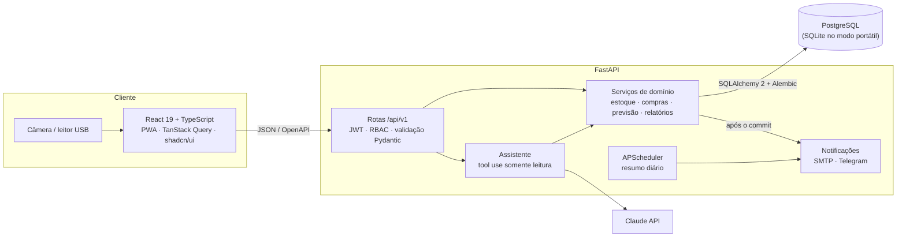

- **Um único deploy:** o FastAPI serve a API e o build do React (mesma origem, cookies simples, sem CORS em produção). A mesma base de código vira imagem Docker ou executável.
- **Camadas:** rotas finas → serviços com as regras de negócio → modelos SQLAlchemy. Os serviços são reutilizados pela API, pelo assistente de IA, pelos relatórios e pelo gerador de dados.
- **Contrato tipado de ponta a ponta:** o OpenAPI gerado pelo FastAPI vira tipos TypeScript (`openapi-typescript` + `openapi-fetch`); o CI falha se backend e frontend saírem de sincronia.

<details>
<summary><b>Estrutura de pastas</b></summary>

```
backend/
  app/
    api/routes/      # auth, produtos, estoque, compras, relatórios, sistema...
    services/        # inventory, purchasing, forecasting, analytics, reports,
                     # labels, importer, alerts, notifications, assistant, audit
    models/          # SQLAlchemy 2 (tipado)
    schemas/         # Pydantic v2
    migrations/      # Alembic (compatível com SQLite e PostgreSQL)
    seed.py          # gerador de 120 dias de dados realistas
  tests/             # pytest (SQLite e PostgreSQL no CI)
frontend/
  src/pages/         # telas (carregadas sob demanda)
  src/components/    # layout, componentes de domínio e shadcn/ui
  src/lib/           # cliente da API, auth, tema, consultas
  e2e/               # Playwright (desktop, mobile e capturas do README)
desktop/             # launcher + spec do PyInstaller (executável portátil)
legacy/              # versão 1.0 em C + GTK
```

</details>

## Decisões técnicas

**Livro de movimentações imutável.** O saldo nunca é editado diretamente: toda alteração gera uma linha no ledger com o saldo resultante, dentro de uma transação que trava o saldo do depósito (`SELECT … FOR UPDATE` no PostgreSQL) — duas saídas simultâneas não deixam o estoque negativo. Transferências geram duas linhas ligadas por um `transfer_id`.

**Previsão de demanda adequada a cada produto.** Médias simples erram muito em almoxarifados, onde vários itens têm consumo esporádico. O sistema escolhe o método pelo padrão de consumo: **Holt com tendência amortecida** para demanda regular e **Croston com correção de Syntetos–Boylan** quando mais da metade dos dias não tem saída. O estoque de segurança usa o erro de previsão: `z(nível de serviço) × σ × √lead time`. A sugestão desconta saldo e pedidos em aberto e respeita o estoque máximo.

**Alertas sem spam.** Um alerta só nasce quando o saldo *cruza* o mínimo (não a cada saída) e é resolvido sozinho quando o estoque volta. E-mail e Telegram são enviados **depois do commit** da transação, em segundo plano — uma falha no SMTP nunca desfaz uma movimentação.

**Sessão segura.** O token de acesso (15 min) fica só em memória no navegador; o refresh token fica em cookie `httpOnly` e é **rotacionado a cada uso**. Se um refresh token antigo for reutilizado (sinal de roubo), todas as sessões do usuário são revogadas. No banco, só ficam hashes.

**IA com acesso controlado.** O assistente usa *tool use* com nove ferramentas de consulta implementadas sobre os mesmos serviços da API. O prompt de sistema é fixo (aproveita o cache de prompt) e o modelo é configurável por variável de ambiente (padrão `claude-opus-5-5`, com *fallback* do lado do servidor em caso de recusa).

**Funciona com e sem servidor.** A mesma aplicação roda com PostgreSQL (online/Docker) ou SQLite com WAL (portátil). As migrações usam o modo *batch* do Alembic para funcionar nos dois bancos, e tipos como datas com fuso e decimais foram tratados para se comportarem igual em ambos.

## Testes

| Camada | Ferramenta | O que cobre |
| --- | --- | --- |
| Backend | pytest (54 testes, ~83% de cobertura) | regras de estoque e custo médio, ciclo de compras, permissões por perfil, rotação de tokens e limite de login, alertas, previsão, curva ABC, importação, exportações e o loop do assistente (cliente Claude simulado) |
| Frontend | Vitest | formatação pt-BR de moeda, quantidades e datas |
| Ponta a ponta | Playwright (8 cenários) | login, cadastro → entrada → kardex, saldo insuficiente, ciclo de compra completo, exportação, perfis de acesso, sessão após recarregar, fluxo mobile do scanner |

```bash
cd backend && uv run pytest --cov            # testes da API
cd frontend && npm test && npm run test:e2e  # unitários e E2E (sobe a aplicação sozinho)
```

O [CI](.github/workflows/ci.yml) roda lint (ruff, oxlint), checagem de tipos, os testes do backend contra **SQLite e PostgreSQL**, o build, os testes E2E e um *smoke test* da imagem Docker. Tags `v*` disparam o [release](.github/workflows/release.yml), que gera os executáveis para Windows e Linux e publica a imagem no GitHub Container Registry.

## Configuração

Todas as opções estão documentadas em [`backend/.env.example`](backend/.env.example). As principais:

| Variável | Para que serve |
| --- | --- |
| `DATABASE_URL` | PostgreSQL (`postgresql://…`) ou SQLite (padrão) |
| `SECRET_KEY` | assinatura dos tokens — obrigatória em produção |
| `DEMO_MODE` | gera dados de exemplo e mostra as contas demo no login |
| `ANTHROPIC_API_KEY` | habilita o assistente com IA (`ANTHROPIC_MODEL` troca o modelo) |
| `SMTP_*`, `TELEGRAM_BOT_TOKEN` | canais dos alertas (ativados na tela de Configurações) |

A documentação interativa da API fica em `/api/docs` (Swagger) e `/api/redoc`.

## História

A versão 1.0 foi desenvolvida como projeto do 2º Exercício Escolar (2EE), orientado pelo professor Hemir da Cunha Santiago, por **Lucas Eduardo, Diego Amaral, Diego Nery e Pedro Gomes**. O código original continua em [`legacy/`](legacy/), e o `estoque.csv` daquela versão pode ser importado na tela **Configurações → Importação**.
